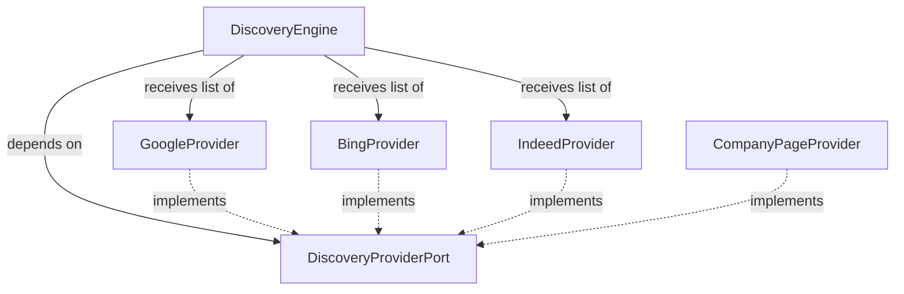
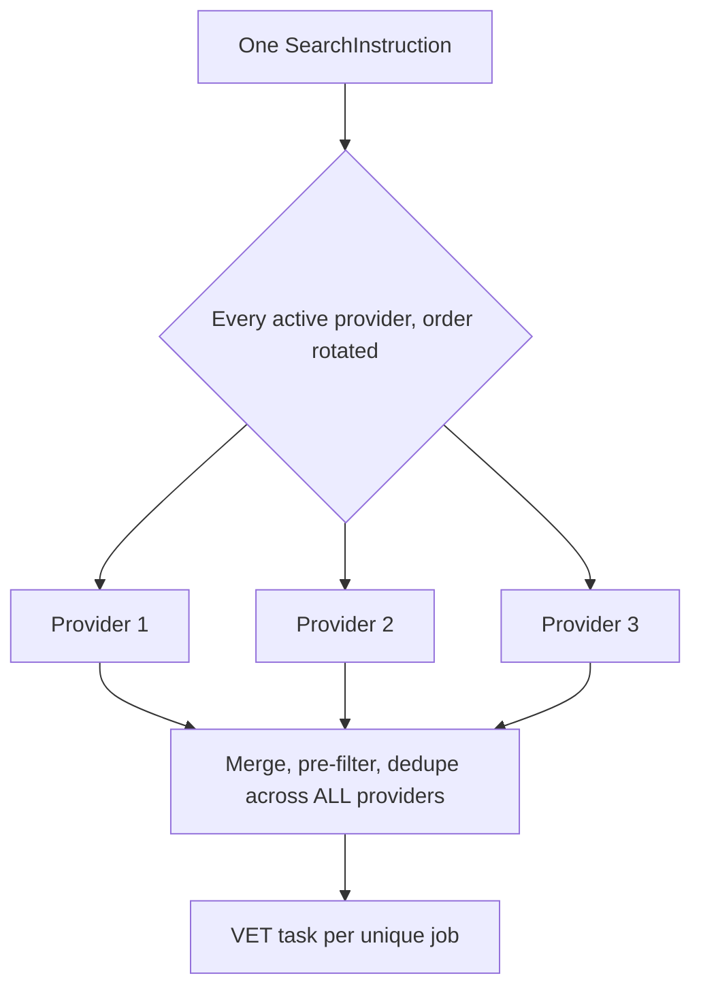

# Discovery Strategies

The Discovery Engine is AA’s job‑hunting scout. It does not know how to
search Google or Bing or Indeed. It only knows how to ask a **provider** to
“go find jobs.” Which provider, which website, which scraping technique — all
of that is injected. This chapter explains the Strategy Pattern that makes the
Discovery Engine adaptable, the ResilientNavigator that gives every provider a
fallback plan, and the internal machinery that turns a search results page
into a list of structured Job objects.

---

## The Strategy Pattern

AA’s Discovery layer follows the **Strategy Pattern**. Instead of one giant
“scrape everything” function, we have many small, independent **provider**
classes. Each provider knows how to scrape exactly one source — Google,
Bing, Indeed, or a company’s careers page.

Every provider must satisfy the `DiscoveryProviderPort` contract, which the
Discovery Engine depends on. The engine is a pure orchestrator: it asks
each injected provider to `run(instruction)`, collects the results,
deduplicates by URL, persists them, and enqueues one VET WorkUnit per
unique job.



The composition root builds the list of providers and injects it into the
workflow. For each search instruction, the workflow calls
`provider.run(instruction)` on **every** active provider, in a seeded order
that rotates between searches. If a provider fails (network error, layout
change), the workflow logs the error and continues to the next provider —
one failure never aborts the entire search. An engine that answers with a
CAPTCHA or a login wall is benched for the rest of the session instead (see
the fan-out section below).

### The DiscoveryProviderPort Contract

```python
class DiscoveryProviderPort(ABC):
    @property
    def name(self) -> str: ...
    
    @property
    def requires_live_browser(self) -> bool: ...
    
    def run(self, instruction: SearchInstruction) -> list[Job]: ...
```

| Method | Purpose |
| ------ | ------- |
| `name` | Canonical lowercase identifier: `"google"`, `"bing"`, `"indeed"`. |
| `requires_live_browser` | Returns `True` if this provider needs a real browser. The composition root excludes browser‑dependent providers when no browser is available. |
| `run(instruction)` | Execute one `SearchInstruction` and return a list of Job objects. May be empty; never `None`. |

---

## How a Provider Works: Inside GoogleProvider

Let’s trace what happens when the workflow calls
`GoogleProvider.run(instruction)`.

### 1. Compose the Search URL from the Instruction

The provider never reads the user profile. It receives one
`SearchInstruction` — title, location, workplace type, optional raw query
string, engine form, date range and result cap — built by the
`DiscoveryWorkflow`, either from the profile's search matrix or, when
ATS-targeted search is engaged, from the deterministic `SearchPlanner`. The
provider composes the URL from it through its engine strategy
(`engine_strategies.build_search_url`):

```python
# generic:         the query text is built from the instruction's title and
#                  location, and sent on the engine's configured form
# site-restricted: instruction.raw_query_string — composed by the catalog's
#                  query composer and bound to this one engine — is sent verbatim
```

The generic Google URL carries `q` plus `ibp=htl;jobs`, `hl=en`, `gl=us` and
`start=0`, the parameters recorded in
`resources/search_surfaces/google.surface.yaml`. A byte-identity pin
(`tests/adapters/test_engine_url_byte_identity.py`) asserts that introducing
the catalog changed none of the bytes automation sends.

### 2. Navigate — with a Fallback Plan

Instead of a single `browser.get(url)` call, the provider uses a
**ResilientNavigator** (see below). The navigator first tries to load the URL
directly. If the page comes back with a CAPTCHA or block, it resets the
browser state (clearing cookies) and tries again, this time by navigating to
the Google homepage, typing the query into the search bar, and clicking the
search button — a slower but much more human‑looking path.

### 3. Extract Job Listings

Once on the results page, the provider first checks for **JSON‑LD structured
data** embedded in the HTML. Many job boards embed job postings as
`application/ld+json` blocks, which are easier and faster to parse than
HTML. If JSON‑LD is present, the provider extracts titles, company names, and
URLs directly from the structured data.

If JSON‑LD is not available, the provider deploys a **GenericSERPStrategy** —
a reusable scraping component that:

1. **Classifies the page** — is it a search results page, a CAPTCHA block, a
   login wall, or an error page? If the page is not a healthy SERP, the
   provider aborts immediately.
2. **Dismisses interruptions** — cookie banners, GDPR consent popups, and
   modal overlays are clicked away so they don’t block job cards.
3. **Scrolls for infinite‑loading pages** — the `InfiniteScrollStrategy` scrolls
   down in increments, waits for new content to load, and detects when the
   feed is exhausted. This handles virtualised lists (Google Jobs widget) where
   only a few cards are in the DOM at any moment.
4. **Mines job cards** — the `SemanticMiner` scans the DOM for semantic
   containers (`role="tree"`, `role="list"`, `role="feed"`) and extracts
   titles, company names, and URLs from each card using heuristic selectors.
5. **Deduplicates within the page** — cards that appear multiple times as the
   user scrolls are merged by URL.

### 4. Return Results

The provider returns a list of `Job` objects, each with `title`, `company`,
`url`, `source`, and `location`. The Discovery Engine then deduplicates across
all providers — the first provider to return a given URL wins.

---

## The ResilientNavigator

Navigation is the most failure‑prone part of any scraping operation. Websites
block IPs, throw CAPTCHAs, or simply change their URL structure. The
`ResilientNavigator` gives every provider a built‑in fallback plan.

It is a composite that holds an ordered list of `NavigationStrategy`
implementations and tries them one by one until a page loads and passes a
health check.

```python
class ResilientNavigator:
    def __init__(self, browser, strategies):
        self._strategies = strategies  # ordered list

    def navigate_with_fallback(self, url, context, validator):
        for strategy in self._strategies:
            strategy.navigate(url, context)
            if validator():           # e.g., "is this a SERP, not a CAPTCHA?"
                return True
            # Reset browser state before next attempt
            browser.get("about:blank")
        return False
```

The two primary navigation strategies are:

| Strategy | Behaviour | Detectability |
| -------- | --------- | ------------- |
| `DirectURLNavigation` | Navigate directly to the constructed search URL. Fastest. | Higher — direct parameterised URLs look like bots. |
| `HumanSearchNavigation` | Navigate to the homepage, type the query into the search bar, and click the search button. Slower, with parabolic typing delays. | Lower — mimics a real user typing a query. |

If `DirectURLNavigation` loads a page that fails the health check (CAPTCHA
detected), the navigator resets the browser state and retries with
`HumanSearchNavigation`. This gives every provider two independent ways to
reach the same results page, dramatically increasing the chance of success.

---

## Fan-out, Pacing and Benching

The `DiscoveryWorkflow` does **not** stop at the first provider that
succeeds. Every instruction is offered to every active provider, and the
results are merged, pre-filtered and deduplicated across all of them. The
order providers are tried rotates between searches (a seeded shuffle), so
runs are not always Google-first.



Three session-wide guards sit in front of the fan-out:

- **Per-host pacing.** One `HostPacer`
  (`application/services/host_pacing.py`) spaces consecutive contacts to any
  single host — engines here, ATS hosts in vetting and applying — by
  `discovery.between_provider_pause_min/max` (1.0–2.0 s by default) with
  seeded jitter. Reservations are taken under a lock, so concurrent workers
  cannot interleave past the floor. robots.txt is not consulted on this
  interactive path: a robots fetch would itself be a request.
- **Benching.** An engine that answers with a CAPTCHA or a login wall is
  benched for the rest of the session, *before any further request is sent*;
  the other engines continue, and the end-of-session summary names the
  benched engine and the reason. A separate guard
  (`SilentDegradationDetector`) benches a provider whose first harvest
  collapses against its own recorded baseline — only when yield *and* page
  size fall together, so a legitimately sparse query never benches anyone.
  Site-restricted harvests keep their own baseline scope, so a thin `site:`
  harvest cannot bench an engine's generic searches.
- **Off-shape handling.** A result that is not a posting of the platform a
  site-restricted search targeted is dropped and counted — or, when
  company-page mining is enabled, routed to it as a `DISCOVER_COMPANY` task.
  Terminal pages (success/confirmation/closed) are never followed. Every
  kept job is stamped with its provenance — provider, query, platform,
  engine form, route, page and rank — stored with the job in
  `job_history.metadata_json`; the results CSV shows all of it except the
  route.

If all providers return nothing, the workflow enqueues no VET tasks and the
orchestrator logs a warning; the session is not aborted.

---

## The Multi‑Query Loop

The Discovery Engine does not perform a single search. By default the
workflow builds one instruction for every combination of **desired job title
× preferred location × workplace type** from the profile. When ATS-targeted
search is engaged (`discovery.use_ats_site_search` plus
`discovery.ats_platforms`), the `SearchPlanner` instead plans one
`site:`-restricted query per **platform × engine × (title, location)** —
each one composed by the search-surface catalog's composer, never
hand-formatted, and only for platforms whose restriction is measured or
vendor-documented. Planning is deterministic: engines rotate innermost,
platforms outermost, and no query is ever reallocated by yield.

Two budgets bind, both session-wide:

- `max_queries_per_session` (a `SessionPlan` field, default 20) caps the
  **total** queries a session sends, across every search task — the workflow
  owns the counter, and instructions beyond the cap are skipped with a
  warning, never silently. Engine rotation carries across task boundaries.
- `max_discovery_results_per_query` (in `runtime_defaults.yaml`) caps how
  many results each provider may return per query.

Both exist to protect low‑end machines and metered connections.

---

## Adding a New Discovery Provider

To add a new job board (e.g., LinkedIn), you only need to write one class
and register it in one place.

1.  Create a new file in `adapters/secondary/discovery/providers/`:
    ```python
    from auto_apply.domain.models.search_instruction import SearchInstruction
    from auto_apply.domain.ports.discovery_port import DiscoveryProviderPort
    from auto_apply.adapters.secondary.discovery.strategies.navigators import (
        DirectURLNavigation,
        HumanSearchNavigation,
        ResilientNavigator,
    )

    class LinkedInProvider(DiscoveryProviderPort):
        name = "linkedin"
        requires_live_browser = True

        def __init__(self, browser, search_prefs):
            self._browser = browser
            self._prefs = search_prefs
            self._navigator = ResilientNavigator(browser, [
                DirectURLNavigation(browser),
                HumanSearchNavigation(browser),
            ])

        def run(self, instruction: SearchInstruction) -> list[Job]:
            # compose the URL from the instruction, navigate, mine jobs...
            return jobs
    ```

2.  Register the provider in the composition root:
    ```python
    providers.append(LinkedInProvider(browser, search_prefs))
    ```

No other files need to change. The Discovery Engine, the orchestrator, and
every workflow that depends on discovery will automatically use the new
provider.

---

## Company Career Page Discovery

Not all jobs are found via search engines. Sometimes a user knows exactly
which company they want to work for and provides a direct link to the
company’s careers page. AA supports this via `DISCOVER_COMPANY` tasks.

When given a URL like `https://acme.com/careers`, AA:

1.  Navigates to the page.
2.  Scans the navigation menus (using `ToolbarNavigator`) for links containing
    “jobs,” “careers,” “open positions,” etc.
3.  Follows the best matching link to the actual job listings page.
4.  Applies the same `GenericSERPStrategy` to extract all job cards.
5.  Returns the list of jobs, which then flows through the normal vetting
    pipeline.

This allows AA to handle both broad “search the web” and targeted “apply
everywhere at this company” workflows with the same underlying machinery.

---

## Graceful Degradation

The Discovery layer respects AA’s worst‑case‑first philosophy at every level:

| Condition | Behaviour |
| --------- | --------- |
| No live browser available | The session refuses to start with an explained error ([ADR‑013](../adr/013_static_path_retirement.md)); no provider is ever run browserless. |
| A provider raises an exception | The exception is caught, logged, and the engine moves to the next provider. |
| A provider returns zero results | The engine tries the next provider. |
| `SpaCy` is not installed | The `TextMatcher` falls back to `difflib.SequenceMatcher` for title matching inside providers. |
| `ATSRegistry` fails to load | The `_ats_site_filters` helper falls back to a hardcoded list of common ATS domains. |

---

## Architecture Summary

- **Providers** are concrete implementations of `DiscoveryProviderPort`. They
  encapsulate all knowledge of a specific website’s URL structure, selectors,
  and quirks.
- **The ResilientNavigator** gives every provider a fallback navigation chain.
- **The Discovery Engine** is a pure orchestrator — it depends only on the
  port, not on any specific provider.
- **Extensibility** is trivial: a new job board is one file + one registration
  line.

This design ensures that AA can adapt to new job boards, survive website
changes, and continue to find jobs even when specific search engines are
unavailable — all without changing the core application logic.

---

## Next Steps

- [Vetting Pipeline](vetting_pipeline.md) — what happens after jobs are
  discovered: how AA decides which ones to apply to.
- [Core Abstractions](core_abstractions.md) — the `DiscoveryProviderPort`
  contract and dependency injection in action.
- [ADR‑004: ATS Platform Registry](../adr/004_ats_platform_registry.md) —
  how AA identifies which ATS a job is hosted on.